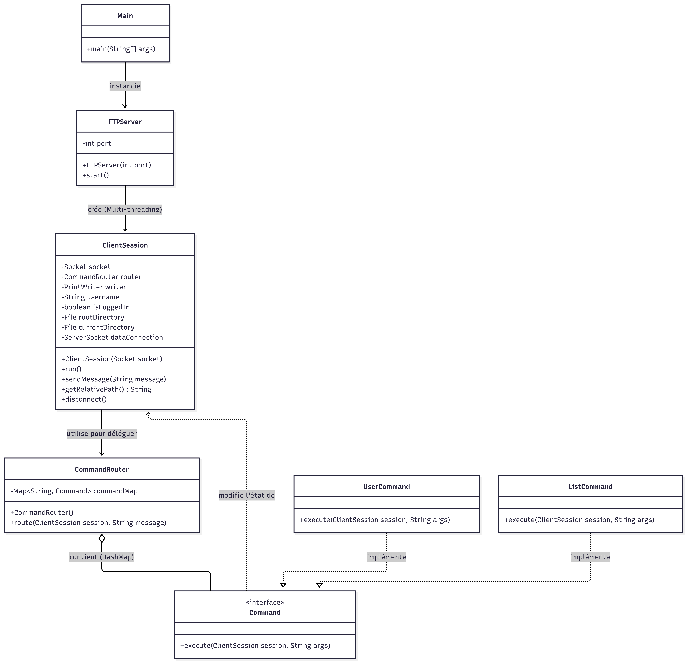
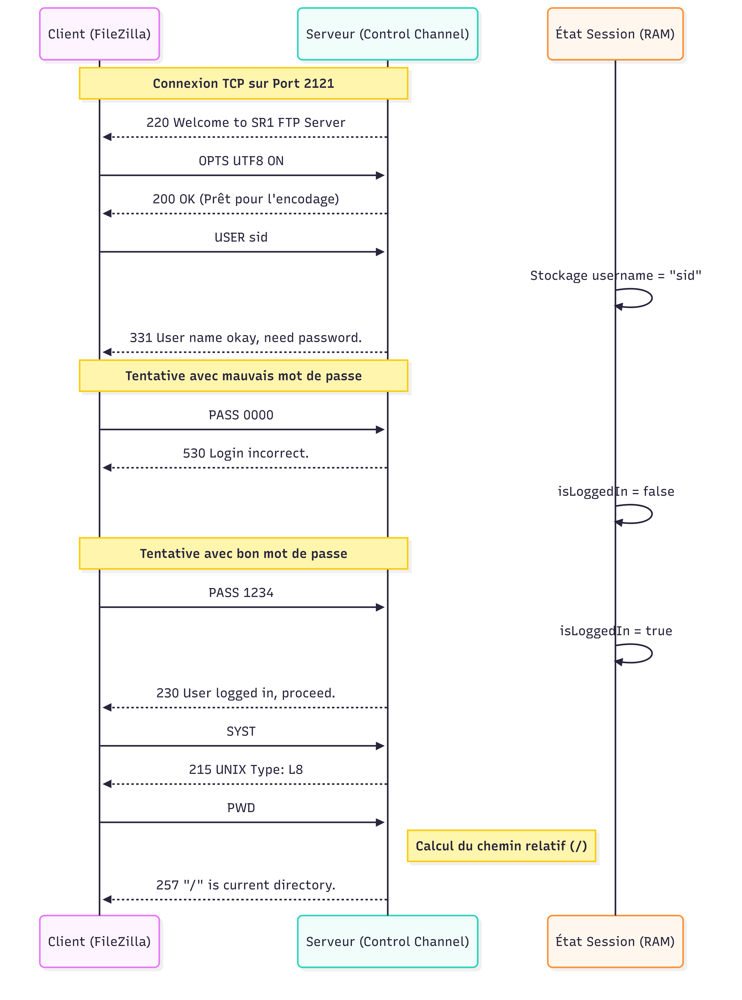
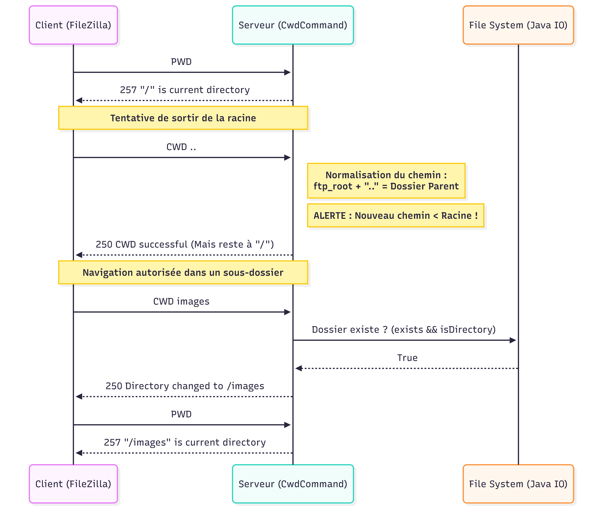
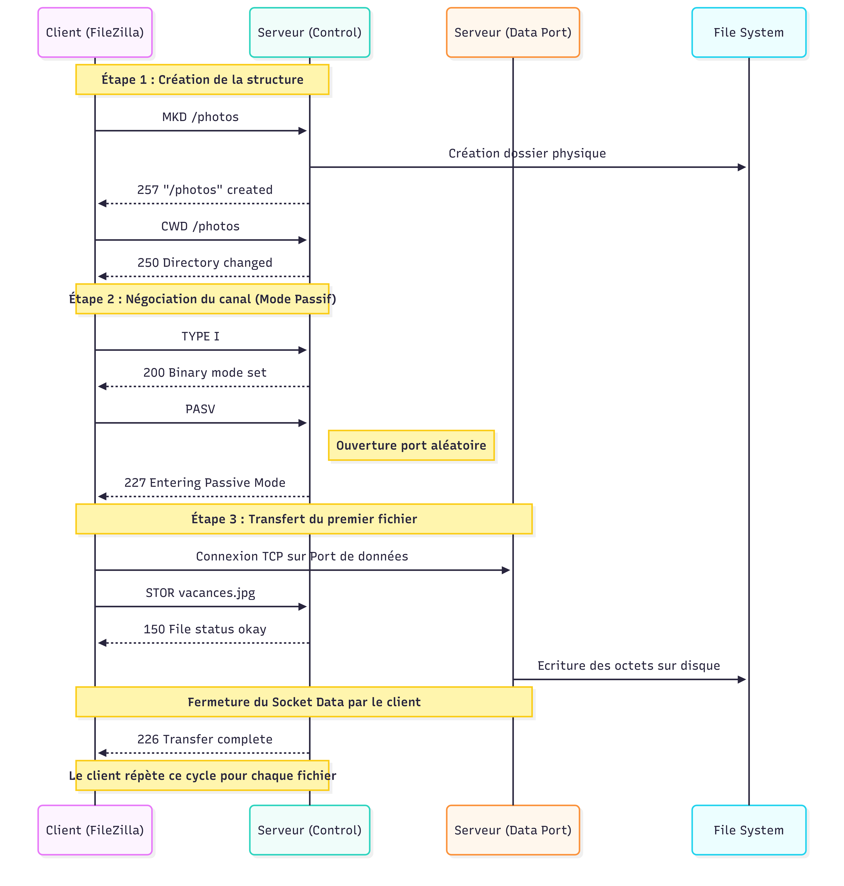
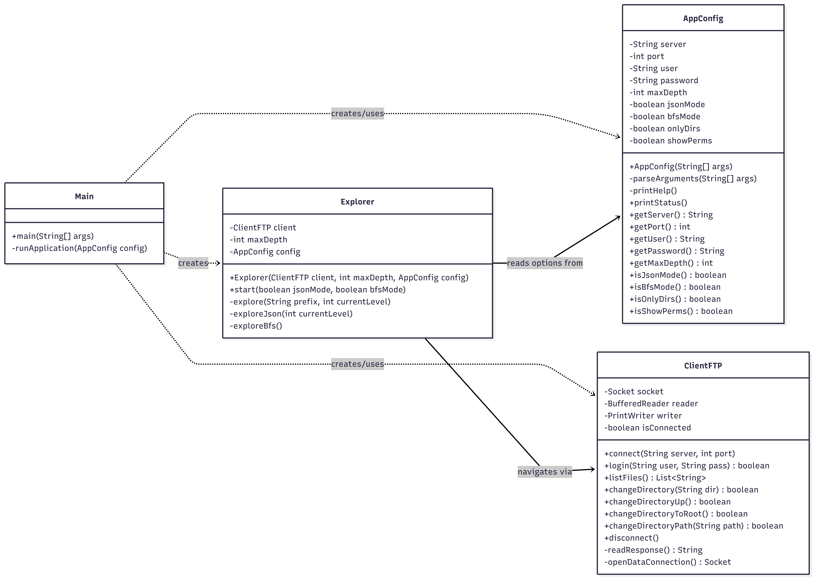

# Java FTP Suite — Custom RFC 959 Multi-Threaded Server & Recursive CLI Client

**Java FTP Suite** is a complete client-server file transfer implementation built from scratch in **Java** using raw TCP sockets and the **RFC 959** protocol specification. The repository unifies two complementary modules: a concurrent FTP server featuring a virtual **Chroot Jail** and Command design pattern, and a recursive CLI exploration client supporting **DFS**, **BFS**, and structured **JSON** output.

---

## Architecture Overview

The repository is organized into two standalone Java modules:

* **`ftp-server/` (Concurrent RFC 959 FTP Server):** Multi-client socket server supporting passive (`PASV`/`EPSV`) data channels, state-machine authentication, virtual filesystem confinement (`ftp_root`), and modular command routing.
* **`ftp-client/` (`TreeFtp` Recursive CLI Client):** Command-line FTP tree explorer capable of recursive Depth-First Search (**DFS**), level-by-level Breadth-First Search (**BFS**), directory filtering, permission inspection, and dependency-free **JSON** export.

### System Diagrams

#### Server Class Architecture (`ftp-server`)


#### Authentication & Session State Machine


#### Chroot Jail Path Security


#### Passive Data Channel & Recursive Transfers


#### Client Class Architecture (`ftp-client`)


---

## Execution Demos

* **FTP Server Demo:** [`docs/demos/server_demo.mp4`](docs/demos/server_demo.mp4)
* **TreeFtp Client Demo:** [`docs/demos/client_demo.mp4`](docs/demos/client_demo.mp4)

---

## Key Technical Features

### 1. Multi-Threaded FTP Server (`ftp-server`)
* **Command Design Pattern (`CommandRouter`):** Each RFC 959 command (`USER`, `PASS`, `PWD`, `CWD`, `LIST`, `PASV`, `EPSV`, `STOR`, `RETR`, `MKD`, `RMD`, `DELE`, `RNFR`, `RNTO`, `TYPE`, `QUIT`) is encapsulated in its own class implementing the `Command` interface for clean extensibility.
* **Stateful Session Management (`ClientSession`):** Enforces strict protocol handshake sequencing—rejecting filesystem commands with `530 Not logged in` until `USER` and `PASS` authentication succeeds.
* **Virtual Filesystem Security (Chroot Jail):** Resolves and canonicalizes target paths on every navigation request (`CWD`, `CDUP`), blocking directory traversal outside `ftp_root` with a `550 Permission denied` response.
* **Ephemeral Passive Data Channels (`PASV` / `EPSV`):** Dynamically opens dedicated `ServerSocket` ports for binary/ASCII file transfers and directory listings.

### 2. Recursive FTP Tree Explorer (`ftp-client`)
* **Dual Traversal Algorithms (`Explorer`):**
  * **DFS (Default):** Recursive tree traversal with backtracking (`CDUP`) and configurable depth limits (`-depth <n>`).
  * **BFS (`-bfs`):** Iterative queue-based level-order traversal across remote directories.
* **Zero-Dependency JSON Serialization:** Builds valid, indented JSON trees natively in Java without external serialization libraries (`-json`).
* **RFC 959 Passive Mode Parsing (`ClientFTP`):** Parses `227 Entering Passive Mode (h1,h2,h3,h4,p1,p2)` responses and computes data ports via $(p_1 \times 256) + p_2$.

---

## Quick Start — FTP Server (`ftp-server`)

### Prerequisites
* **Java:** JDK 17 or higher

### Option 1: Compile & Run Directly
From the `ftp-server/` directory:

```bash
cd ftp-server
mkdir -p bin
javac -d bin -sourcepath src src/Main.java
java -cp bin Main
```

### Option 2: Package & Run as Executable JAR
```bash
cd ftp-server
jar cfe ServeurFTP.jar Main -C bin .
java -jar ServeurFTP.jar
```

On startup, the server prints `Starting FTP Server on port 2121` and serves files confined to `ftp-server/ftp_root/`.

### Default Test Credentials (FileZilla or CLI)
| Parameter | Default Value | Source Location |
| :--- | :--- | :--- |
| **Host** | `localhost` | — |
| **Port** | `2121` | `src/Main.java` (`int port = 2121;`) |
| **Username** | `user` (any non-empty username) | `src/commands/UserCommand.java` |
| **Password** | `sr1` | `src/commands/PassCommand.java` |

### Running Server Unit Tests (JUnit 5 Standalone)
From the `ftp-server/` directory:

* **Linux / macOS:**
  ```bash
  mkdir -p bin_test
  javac -d bin_test -cp "bin:lib/*" test/server/*.java test/commands/*.java
  java -jar lib/junit-platform-console-standalone-1.14.3.jar -cp "bin:bin_test" --scan-classpath
  ```
* **Windows (CMD / PowerShell):**
  ```cmd
  mkdir bin_test
  javac -d bin_test -cp "bin;lib/*" test/server/*.java test/commands/*.java
  java -jar lib/junit-platform-console-standalone-1.14.3.jar -cp "bin;bin_test" --scan-classpath
  ```

### Generating Server JavaDoc
```bash
cd ftp-server
mkdir -p javadoc
javadoc -d javadoc -sourcepath src src/Main.java src/server/*.java src/commands/*.java
```

---

## Quick Start — TreeFtp CLI Client (`ftp-client`)

### 1. Compile & Package
From the `ftp-client/` directory:

```bash
cd ftp-client
mkdir -p bin
javac -d bin src/fr/univlille/sr1/treeftp/*.java

# Optional: build executable JAR
jar cfe TreeFtp.jar fr.univlille.sr1.treeftp.Main -C bin .
```

### 2. Run Against Your Local FTP Server (`localhost:2121`)
```bash
java -cp bin fr.univlille.sr1.treeftp.Main localhost 2121 user sr1 -p
```

### 3. Run Against a Public FTP Server (`ftp.free.fr`)
```bash
# Via classpath
java -cp bin fr.univlille.sr1.treeftp.Main ftp.free.fr 21 anonymous guest -depth 1

# Or via packaged JAR
java -jar TreeFtp.jar ftp.free.fr 21 anonymous guest
```

### CLI Options
| Flag | Description |
| :--- | :--- |
| `-depth <n>` | Limit recursion depth (e.g., `-depth 2`) |
| `-json` | Output directory tree as structured JSON |
| `-bfs` | Traverse directories using Breadth-First Search (`Queue`) instead of DFS |
| `-d` | Display directories only |
| `-p` | Display Unix file permissions (e.g., `drwxr-xr-x`) |

### Client Tests & Integration Scripts
From the `ftp-client/` directory:

```bash
# Unit test for CLI argument parsing (no network required)
java -cp bin fr.univlille.sr1.treeftp.AppConfigTest

# Integration test suite against public FTP server (Linux/macOS)
./scripts/test_public_free.sh
```
*(On Windows, run `scripts\test_public_free.bat`.)*